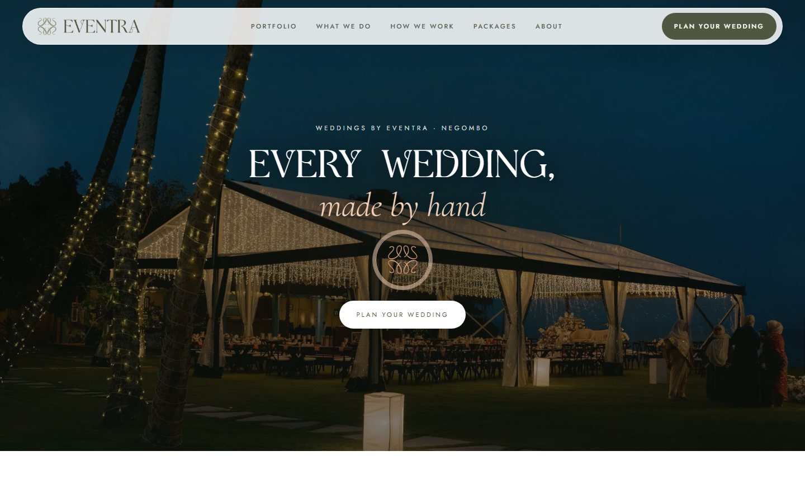
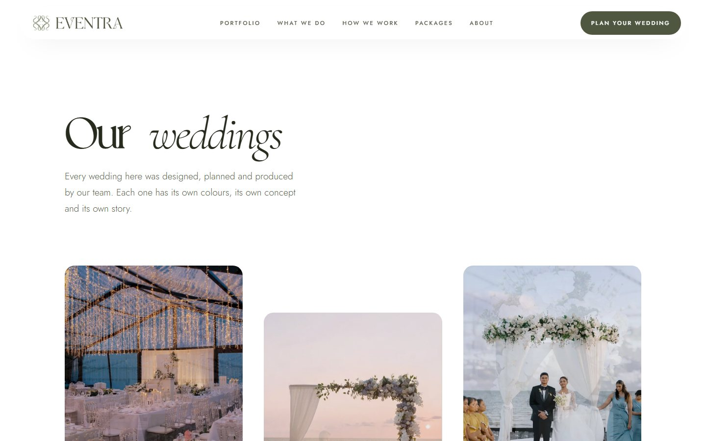
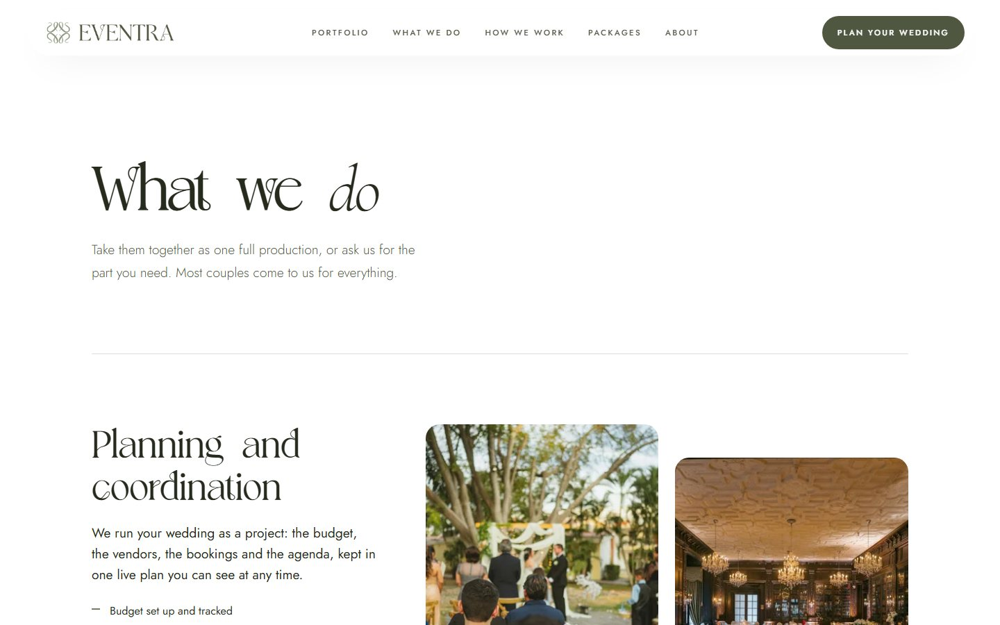
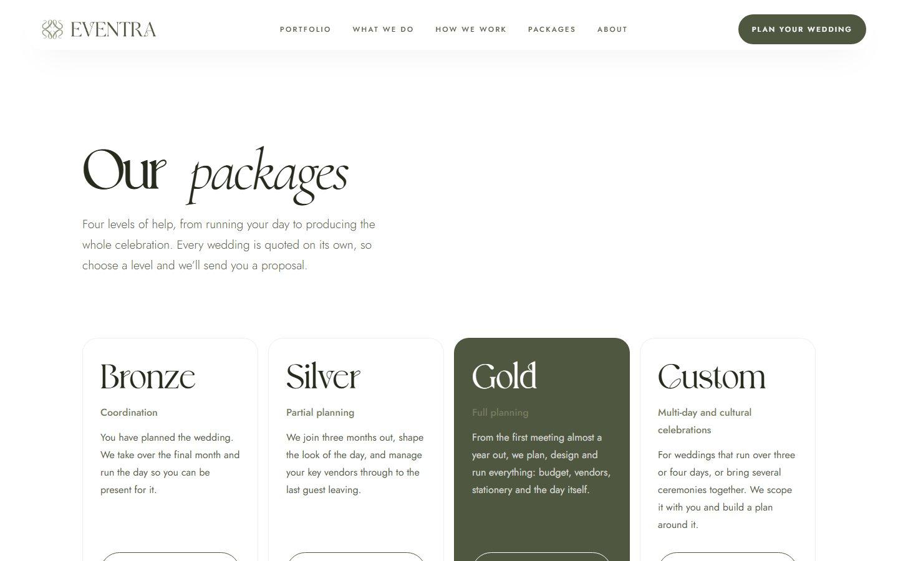
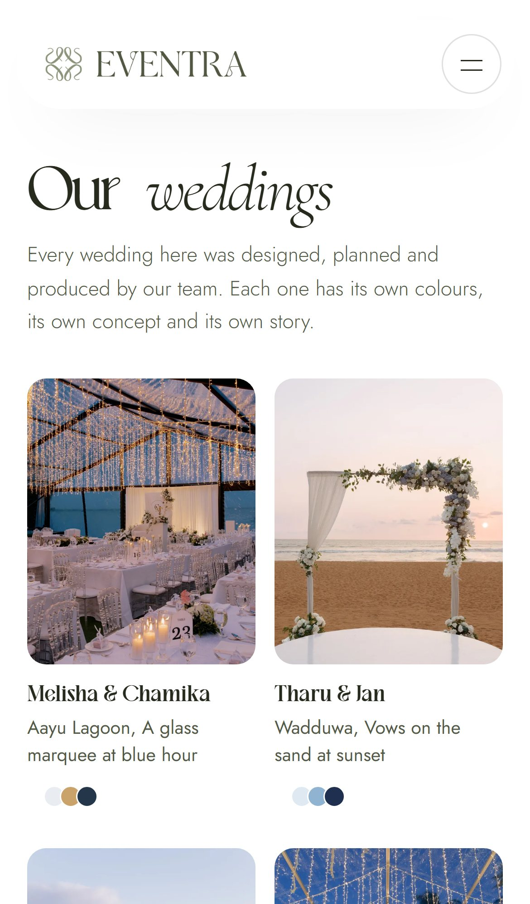

# Weddings by Eventra

**Website for wedding planners and producers in Negombo, Sri Lanka**

Planning · design and florals · production

**[Visit the live site](https://eventra-website-blush.vercel.app)**

> [!NOTE]
> This is a **showcase repository**: it presents the project, not its source code. The code is private.
> Weddings by Eventra was designed and built by **Tehan Athaudage** ([Website by TA](https://websitebyta.vercel.app)).

| | |
|---|---|
| **Type** | Client website + CMS |
| **My role** | Design and development |
| **Built by** | Tehan Athaudage (Tehan Gimsara), Website by TA |
| **Live** | https://eventra-website-blush.vercel.app |

## About the project

Eventra designs, builds and runs luxury and outdoor weddings. The client wanted very little text, clean line-art drawings and a home page that follows their own hand-drawn sketch, with the weddings themselves doing the selling.

## What I built

| | |
|---|---|
| **Story-led home page** | Scenes built from the client's sketch, opening on a pair of doors and the planning journey drawn as a path. |
| **Wedding portfolio** | Each wedding has its own page, concept, venue and colour palette. |
| **Services and packages** | Planning, design, production, stationery and bar, with Bronze, Silver, Gold and custom packages. |
| **Sanity CMS** | The team edits weddings, journal posts and settings in Sanity; without it the site reads from local content. |
| **Local SEO** | A dedicated wedding-planners-in-Negombo page, journal, structured data and sitemap. |
| **Lighter on slow phones** | Scrolling and animations tuned for older phones and laptops. |

## Screens

<table>
<tr>
<td width="50%"> <b>Our weddings</b></td>
<td width="50%"> <b>What we do</b></td>
</tr>
<tr>
<td width="50%"> <b>Packages</b></td>
<td width="50%"> <b>Weddings on a phone</b></td>
</tr>
</table>

## Tech stack

Next.js 16 · React 19 · TypeScript · CSS Modules · Sanity CMS · Vercel

## Want something like this?

I'm Tehan Athaudage, a freelance web designer and developer from Sri Lanka working with businesses worldwide.

[Portfolio](https://websitebyta.vercel.app) · [LinkedIn](https://www.linkedin.com/in/tehan-athaudage-663102382/) · [Instagram](https://www.instagram.com/websitebyta/) · [Facebook](https://www.facebook.com/Thalric1) · [Email](mailto:websitebyta@gmail.com) · [WhatsApp](https://wa.me/94761629355)

---

© 2026 Tehan Athaudage. Showcase only: see [NOTICE.md](NOTICE.md). Client names, logos and photos belong to their owners.
